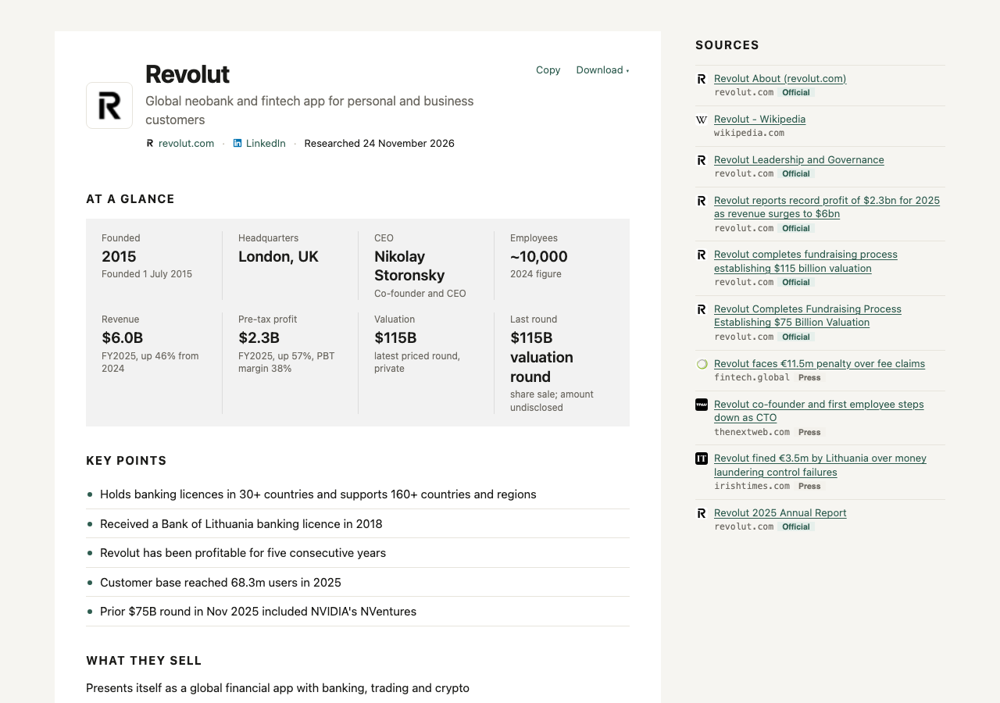

# Company Research for Claude Code

**Type a company name. Get a sourced one-page brief in about 20 seconds.**

**Who it's for:** Investors (VCs, angels, private equity) · Analysts and consultants · Corporate deal and strategy teams · Sales and marketing teams · Founders · Job seekers and recruiters · Journalists and podcasters



```
/company-research:brief Revolut
```

What it does, the numbers, main competitors, recent news and red flags. Four fast AI agents search in parallel, and the report opens in your browser right away and fills in live, with PDF and Word downloads. See more finished examples in [`examples/`](examples/).

**No API keys and no extra cost.** It runs inside Claude Code and uses Claude Code's built-in web search. Research counts toward your normal Claude plan usage.

## Install

In Claude Code, run:

```
/plugin marketplace add buketmat/claude-company-research
/plugin install company-research@company-research
```

Then restart Claude Code (or run `/reload-plugins`).

## Use

| Command | What you get | Status |
|---|---|---|
| `/company-research:brief <company>` | A short, sourced snapshot in about 20 seconds | Available |
| `/company-research:deep-dive <company>` | A full, in-depth company research report | Coming soon |

```
/company-research:brief Mastercard
/company-research:brief linear.app
```

Or just ask: *"Give me a brief on Revolut."*

The report is saved in a `company-briefs/<company>-<date>/` folder inside the folder you're working in, and opens in your browser. See finished examples in [`examples/`](examples/): Mastercard (listed), Revolut (late-stage private), Linear (startup, no red flags) and Bolt (startup with red flags).

## What's in the report

Short on purpose: tiles and one-line points, not paragraphs.

| Part | What you get |
|---|---|
| **Header** | Logo, name, one-line description, website, LinkedIn page, research date |
| **At a glance** | Founded, HQ, CEO, employees, revenue, profit, and either stock and market cap or total raised, valuation and last round |
| **Key points** | 3 to 5 sourced points the tiles don't cover |
| **What they sell** | How the company positions itself, products as small cards, business model, customers, investors |
| **Main competitors** | 3 to 5 closest competitors with their icons, category, market position |
| **Recent news** | 3 to 5 dated items from the last 12 months |
| **Red flags** | Only shown when something is found. Every company is checked for layoffs, founder departures, lawsuits or regulatory trouble, a down round and a long gap since the last raise (18 months or more), plus other serious problems such as data breaches, executive exits, losing a major customer or cash trouble |
| **Sources** | A sidebar of 10 to 16 sources with site icons, marked Official or Press |

It's a brief, so the text stays clean: no footnote numbers. Every source used is listed in the sidebar. Facts that weren't found are listed at the end; the agents are told never to guess. A Copy button copies the brief as text, and a Download menu gives you a PDF, a Word file (.docx) and a single-file HTML version.

## How it works

```
                ┌─ cr-company  (what it does, products, founded, HQ, CEO, size, LinkedIn)
                ├─ cr-money    (revenue, profit, market cap or funding, down rounds)
 company name ──┼─ cr-news     (last 12 months, red-flag searches)          ──► live report ──► report.html
                ├─ cr-market   (main competitors, category, position)            fills in        + PDF + Word
                └─ report.py   (logo, live page, merge, red flags, exports)
```

- **Four research agents** (`agents/`) run on Claude Haiku at low effort for speed. Each sends two or three web searches at once, in a single round, and writes a small JSON file listing at most four sources.
- **The script** (`skills/brief/scripts/report.py`, Python standard library only) starts at the same time. It fetches the logo, opens a live page that fills in as each agent's file lands, then merges the four files, removes duplicate sources, keeps only dated news from the last 12 months, works out the red flags, and writes the final report, PDF and Word file.

## Speed

The report opens in your browser a few seconds after you press Enter, with the logo and name, and fills in live as each agent finishes. In tests the full report was complete about 20 to 23 seconds after the agents started (plus about 5 seconds for Claude to start them). Search speed varies a little from run to run. Hosted research apps can be faster because they call a search API directly; this plugin trades a few seconds for running inside Claude Code at no extra cost.

## Downloads

Every run saves `<Company>-brief-<date>.pdf` and `<Company>-brief-<date>.docx` next to the report. The PDF is A4, two pages at most. Page 1 is the whole brief (the layout shrinks until it fits); page 2 is the list of sources, each a clickable link. It's made with the Chrome, Edge or Chromium already on your computer; if none is installed, the Download PDF button opens your browser's Save as PDF instead. To use a specific browser, set `BRIEF_RESEARCH_BROWSER` to its path.

## Look

The report uses a clean layout with soft colours: one tinted band for the key figures, open sections with hairlines and clear capital section titles. It has light and dark modes and a phone layout. To try another built-in look, set `BRIEF_RESEARCH_THEME` to `square`, `editorial`, `memo`, `sheet` or `classic`.

## Requirements

- Claude Code with web search available (a Claude Pro, Max, Team or Enterprise plan, or an Anthropic API key)
- Python 3.8 or newer (preinstalled on macOS and most Linux; on Windows, install it from python.org). Nothing else to install.

## Good to know

- A run uses about 11 web searches and 4 small agents.
- The report shows site icons from Google's public favicon service, so opening it loads those small images from Google.
- Small private companies often have gaps, and the report shows them as "Not found".
- Facts are gathered by AI. Check anything important at the source before you rely on it. The report is evidence, not advice.

## License

MIT
